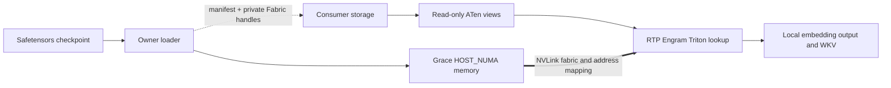

# Shared Engram development checkpoint

Based on public RTP-LLM `main` at
`492ecf45b3ef55b22fd4882622abfdb2e2f664f2`.
This is an experimental external-storage backend, file bootstrap and opt-in
model loading hook. The small-fixture Engram loading/hash/lookup/native
quantization/DeepGEMM/layer-forward path has passed locally and across
hosts/containers. The complete 188.83 GiB real Engram generation has also passed
cross-host lookup. One complete 40-layer RTP instance with TP4/EP4/DP1 has now
passed an eager OpenAI chat smoke over the shared tables. This is correctness
and request-plumbing evidence, not latency or production-service acceptance.

An owner allocates immutable Engram weights/scales in Grace host NUMA memory.
Independent consumers import the same CUDA Fabric allocations and expose
read-only ATen views to RTP's existing Engram lookup. Online lookup has no RPC
or owner CPU request handling. Data reads still consume memory/fabric bandwidth.

A different container is not sufficient for a cross-host test: owner and at
least one consumer must run on different Linux hosts in a supported, authorized
fabric domain. GPU visibility alone does not establish EGM or IMEX usability.

## Code map

| Component | Location | Responsibility |
| --- | --- | --- |
| Manifest | `rtp_llm/models_py/modules/dsv41/engram_manifest.py` | Complete immutable generation, tensor layout and allocation bounds |
| Sessions | `engram_sessions.py` in the same directory | In-process acquire/ACK/renew/drain/release/retire state machine |
| Owner checkpoint loader | `engram_checkpoint.py` | Standard safetensors preflight, budgets and chunked loading |
| Consumer storage | `engram_storage.py` | Deduplicated import, explicit verification, guarded Graph lifetime |
| RTP adapter | `engram.py` | `HostEngramEmbedding.from_storage`; optional `Engram.from_checkpoint(..., external_storage=...)` |
| Native bridge | [native](native/README.md) | CUDA VMM/Fabric allocation/import and external ATen view ownership |
| Component integration | [integration](integration/README.md) | Deterministic checkpoint, real RTP lookup/hash and Graph tests |
| Layout experiments | [latency](latency/README.md) | Canonical preprocessing, gather/scale packing and paired benchmarks |
| Framework bootstrap | `engram_bootstrap.py`, `engram_model_attach.py` and [framework tests](FRAMEWORK_VALIDATION.md) | Trusted private-file attach, transactional model loading and eager-only guards |
| Platform probes | [probe](probe/README.md) | Small EGM, container device and Python/CUDA checks |

The default model checkpoint path remains unchanged. Consumer external-checkpoint
construction reads local WKV/q/k weights and validates external Engram layout;
it must not create a second full embedding table.

## Lifecycle contract

The guarded-Graph steps below belong to the isolated storage component API.
The new model loading hook supports eager execution only.

1. Receive an authenticated complete manifest and private opaque capabilities.
2. `FabricEngramStorage.attach(...)` establishes MAPPED state, not READY.
3. `storage.verify(callback)` requires trusted GPU-read verification and an
   explicit `True` result before admitting READY.
4. Construct the layer adapter and keep storage alive during all GPU work.
5. Use `CapturedEngramGraph.capture(forward, [storage])` for captured work.
   Raw views captured without a storage lifetime guard are unsupported.
6. Stop submissions, drain and close Graphs, release external tensor views, then
   close consumer storage. Live aliases/Graphs prevent early unmapping.
7. Release the owner only after all consumers have quiesced and detached.

Cleanup failure preserves resources and fails the operation. Lease expiry,
control disconnection and `Release(quiesced=True)` are not hardware fencing.
The session registry has no network transport. The harness uses authenticated
file transfer, not production service discovery.

## Status and next milestone

See the [component checkpoint](CHECKPOINT_VALIDATION.md) and
[framework validation](FRAMEWORK_VALIDATION.md). The latter records real
cross-host tokenizer/hash/lookup, incorrect-sample rejection, and genuine native
model-hook/layer-forward checks with a v2 fixture. It also records Owner cleanup
and actual Bazel CPU tests. These are not full-model HTTP or latency results.

The experimental `RTP_ENGRAM_EXTERNAL_BUNDLE` switch enables trusted private-file
bootstrap; absence preserves legacy behavior. The launcher pins dataset/model
revision through the bundle and keeps the Owner alive. Local model configuration
does not yet independently pin those identities. This path is eager only, retains
mappings for process lifetime and rejects unsupported engine Graph capture.
There is no live detach, reload, service discovery or silent table fallback.

The default 1 GiB/allocation and bootstrap 8 GiB total limits remain. Explicit
local [capacity configuration](CAPACITY.md) can raise them to the new native
128 GiB/allocation ceiling and a 256 GiB generation budget; 64 MiB loading chunks
remain. The rebuilt native bridge and a real cross-host 4.125 GiB
[boundary lookup](framework/LARGE_OFFSET_PROBE.md) passed. The complete real-table
[188.83 GiB cross-host lookup](framework/REAL_CHECKPOINT_LOOKUP.md) now also passed:
12 cases were exact in BF16, the consumer checkpoint contained no full tables,
PyTorch attach allocation was zero, and the consumer closed with all eight
native counters zero. Four concurrent lookup consumers then passed
[48 exact cases](framework/MULTICONSUMER_LOOKUP_RESULTS.json) while simultaneously
holding the same two allocations on four GPUs; unique Owner backing stayed
188.83 GiB. These are lookup processes, not four full serving instances.
A subsequent [full-model HTTP smoke](framework/FULL_MODEL_HTTP.md) passed with
one complete four-worker RTP instance: health 200, 26 readable completion
tokens, and normal stop. See the [HTTP result](framework/FULL_MODEL_HTTP_RESULTS.json).
After verified consumer exit, explicit Owner STOP produced CLOSED with all eight
native counters zero. Five task-owned leftover Python processes required targeted
cleanup; automatic complete service teardown is not established. Its expanded
[service-entry import preflight](framework/FULL_MODEL_RUNTIME_RESULTS.json) and
16 CPU helper tests passed, including the attention lazy-import dependency,
preserving all existing package versions and native libraries; that does not
establish model or HTTP readiness.
All 48 original checkpoint shards passed official SHA256 verification; the
[staged consumer](framework/CHECKPOINT_STAGING_RESULTS.json) retains the full
model while omitting complete Engram tables. Earlier second-layer allocation
OOMs are historical attempts, retained as NUMA admission evidence.
On the measured driver/kernel, the two EGM mappings had 188.83 GiB resident RSS
while the verified Owner container cgroup reported about 10.23 GiB current
memory. Container quotas alone therefore do not guarantee EGM admission or
capacity enforcement for this path; keep explicit budgets and NUMA checks.
Remaining gates include local-table numerical comparison at full model
geometry, two independent serving instances and steady-state performance. The
additional 100-microsecond target remains unpassed. Production companion
containers, Owner service deployment and HA are outside this checkpoint.
The VMM/native bridge is prebuilt before startup and is not compiled by
bootstrap during forward. Triton/DeepGEMM kernels may JIT on first use; warmup
and steady-state latency still need validation. Online lookup does not use
Owner RPC.
