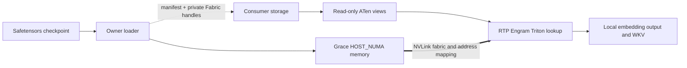

# Shared Engram development checkpoint

Based on public RTP-LLM `main` at
`492ecf45b3ef55b22fd4882622abfdb2e2f664f2`.
This is an experimental external-storage backend and component test harness.
It is not yet wired through a complete RTP model server.

An owner allocates immutable Engram weights/scales in Grace host NUMA memory.
Independent consumers import the same CUDA Fabric allocations and expose
read-only ATen views to RTP's existing Engram lookup. Online lookup has no RPC
or owner CPU request handling. Data reads still consume memory/fabric bandwidth.

A different container is not sufficient for a cross-host test: owner and at
least one consumer must run on different Linux hosts in a supported, authorized
fabric domain. GPU visibility alone does not establish EGM or IMEX usability.

## Code map

| Component | Location | Responsibility |
| --- | --- | --- |
| Manifest | `rtp_llm/models_py/modules/dsv41/engram_manifest.py` | Complete immutable generation, tensor layout and allocation bounds |
| Sessions | `engram_sessions.py` in the same directory | In-process acquire/ACK/renew/drain/release/retire state machine |
| Owner checkpoint loader | `engram_checkpoint.py` | Standard safetensors preflight, budgets and chunked loading |
| Consumer storage | `engram_storage.py` | Deduplicated import, explicit verification, guarded Graph lifetime |
| RTP adapter | `engram.py` | `HostEngramEmbedding.from_storage`; optional `Engram.from_checkpoint(..., external_storage=...)` |
| Native bridge | [native](native/README.md) | CUDA VMM/Fabric allocation/import and external ATen view ownership |
| Component integration | [integration](integration/README.md) | Deterministic checkpoint, real RTP lookup/hash and Graph tests |
| Layout experiments | [latency](latency/README.md) | Canonical preprocessing, gather/scale packing and paired benchmarks |
| Platform probes | [probe](probe/README.md) | Small EGM, container device and Python/CUDA checks |

The default model checkpoint path remains unchanged. Consumer external-checkpoint
construction reads local WKV/q/k weights and validates external Engram layout;
it must not create a second full embedding table.

## Lifecycle contract

1. Receive an authenticated complete manifest and private opaque capabilities.
2. `FabricEngramStorage.attach(...)` establishes MAPPED state, not READY.
3. `storage.verify(callback)` requires trusted GPU-read verification and an
   explicit `True` result before admitting READY.
4. Construct the layer adapter and keep storage alive during all GPU work.
5. Use `CapturedEngramGraph.capture(forward, [storage])` for captured work.
   Raw views captured without a storage lifetime guard are unsupported.
6. Stop submissions, drain and close Graphs, release external tensor views, then
   close consumer storage. Live aliases/Graphs prevent early unmapping.
7. Release the owner only after all consumers have quiesced and detached.

Cleanup failure preserves resources and fails the operation. Lease expiry,
control disconnection and `Release(quiesced=True)` are not hardware fencing.
The session registry has no network transport. The harness uses authenticated
file transfer, not production service discovery.

## Status and next milestone

See [checkpoint validation](CHECKPOINT_VALIDATION.md) for completed component
checks, the distinction between historical GPU results and publication checks,
and unpassed performance/full-model gates.

Next work is framework integration: attach before model construction, thread the
storage through all required layers/ranks, manage engine-owned CUDA Graphs,
and prove two independent cross-host RTP instances can serve requests from one
backing. Production companion containers, Owner service deployment and HA are
outside this checkpoint. Native builds happen explicitly before tests; no JIT
build or control-plane work belongs in the model forward path.
