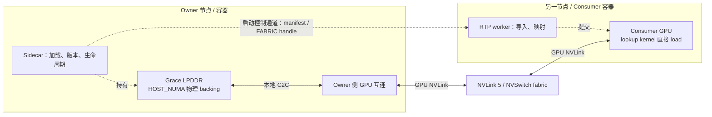

# NVL72 Engram 共享内存：拓扑与放置

2026-10-21。本文区分 NVIDIA 官方规格、两台任务机器的现场观察和待验证设计。相关性能代码基线为 `3ac1fbda79b3509b554b562775a46138d586afd3`，release 基线为 `cb42b084a8a6350daa70897555f18d5f1b47f58e`。

**推荐基线：Grace HOST_NUMA EGM + FABRIC handle + consumer GPU 直接读取。** Sidecar 持有物理内存；consumer 启动时导入映射，在线查表不经过逐行 RPC。跨节点真实表 lookup 已验证可用，但现有 Graph 测量仍有约 **207.424 μs** 的正向增量超限，不能宣布延迟目标通过。[组件结果与全部异常](results/20261021_release_components/README.md)

## 1. C2C 与 rack fabric 是两层互连

| 项目 | GB200 NVL72 | GB300 NVL72 |
|---|---|---|
| Rack | 36 Grace CPU + 72 Blackwell GPU | 36 Grace CPU + 72 Blackwell Ultra GPU |
| Compute tray | 2 Grace + 4 GPU，即两个 1 CPU / 2 GPU 计算组 | 同左 |
| Rack 参考组成 | 18 compute trays + 9 NVLink switch trays | 同左 |
| GPU scale-up | **NVLink 5，1.8 TB/s/GPU** | **NVLink 5，1.8 TB/s/GPU** |
| 本地 Grace–GPU 互连 | NVLink-C2C，900 GB/s 双向规格 | 同属 Grace–Blackwell C2C 路径 |

来源：[GB200 tuning overview](https://docs.nvidia.com/multi-node-nvlink-systems/multi-node-tuning-guide/overview.html)、[DGX GB200/GB300 硬件指南](https://docs.nvidia.com/dgx/dgxgb200-user-guide/hardware.html)、[GB300 产品规格](https://www.nvidia.com/en-us/data-center/gb300-nvl72/)、[GB300 SuperPOD RA，第 18 页](https://docs.nvidia.com/pdf/dgx-spod-gb300-ra.pdf#page=19)、[Grace–Blackwell C2C 技术说明正文](https://developer.nvidia.com/blog/reducing-high-bandwidth-memory-bottlenecks-in-jax-based-llm-training-with-host-offloading/)。

GB300 RA 明确每 GPU 有 18 条 NVL5 link，分别连接 18 个 switch ASIC。**整个 rack 不是一条 C2C，也不是一个 Linux NUMA 主机。** 900 GB/s 为双向互连规格，不代表每张 GPU 能同时从同一个 Grace 读取 900 GB/s；rack 总带宽不能当作单 owner 的可用带宽。以上规格都不是随机 embedding lookup 的延迟承诺。

CUDA 13.0 已给出 HOST_NUMA + FABRIC 的跨节点流程，并明确：**“For remote memory accesses, GPU NVLink and, in some cases, NVLink-C2C are used.”** [CUDA 13.0 EGM](https://docs.nvidia.com/cuda/archive/13.0.0/cuda-c-programming-guide/egm.html)

图表示根据官方拓扑推导的路径分段，**不是某次请求的逐 link trace**。Owner 侧 GPU 表示硬件互连转发，不要求 sidecar CPU 逐行处理，也不要求在 owner HBM 再存完整表。选中行仍有互连流量和 consumer 输出开销；共享完整表不等于零字节传输。当前没有证据指定流量经过 owner 哪张 GPU、哪个端口或各段的微秒耗时。

## 2. 分配与容器边界

- 原 host-pinned baseline 使用 `_PinnedSharedTable`；不能假设任意 `cudaHostRegister` 指针都可以导出 FABRIC。
- EGM 使用 `cuMemCreate` 的 **PINNED + HOST_NUMA + FABRIC** 属性组合。NUMA id 属于 owner 本地主机，不是远端内存编号；PINNED 字样本身也不能证明物理内存在 Grace。
- Consumer import 后 reserve/map/set-access，获得自己的虚拟地址。不同进程指针可以不同，仍访问同一 backing。
- CUDA 13.0 明确普通 `HOST` allocation 不支持 IPC；exporter/importer 还必须有匹配的 IMEX channel 权限。设备节点存在不等于导入成功。[CUDA 13.0 VMM API](https://docs.nvidia.com/cuda/archive/13.0.0/cuda-driver-api/group__CUDA__VA.html)
- 官方 EGM 文档提醒设备 cgroup 裁剪可能阻断路由；设备权限与 `CUDA_VISIBLE_DEVICES` 必须分别核验。容器是进程/权限边界，不是物理距离分类。[CUDA 13.0 EGM](https://docs.nvidia.com/cuda/archive/13.0.0/cuda-c-programming-guide/egm.html)

## 3. 两台 GB200 的现场拓扑

两台任务机器的观察一致；以下 GPU 编号均为**各自主机局部编号**，不能作为 rack ordinal。原始硬件标识已移除，源快照 SHA 与结构化字段见[脱敏拓扑摘要](results/20261021_topology/topology_snapshot_summary.json)。

| 观察项 | 两台机器的结果 | 证据边界 |
|---|---|---|
| GPU / driver | 各 4 GPU；580.95.05 | 不是整 rack 72 GPU 清单 |
| GPU0/1 | CPU affinity 0–71，HOST NUMA0 | 同一 Grace 内存亲和组 |
| GPU2/3 | CPU affinity 72–143，HOST NUMA1 | 另一 Grace 内存亲和组 |
| Grace 内存 | NUMA0 500,645,568 KiB；NUMA1 501,684,864 KiB | OS 总量，不是当前容器可申请预算 |
| NUMA2…33 | 无 CPU，MemTotal=0 | 不能当成额外 Grace DRAM 池 |
| Host 内 GPU 配对 | 非对角 NV18，P2P read/write 均 OK | 非跨节点性能结果 |
| Fabric | 相同 cluster/clique；各 GPU Completed / Success / Healthy / Full | 身份相等性和状态，非请求路由证明 |
| GPU NVLink 状态 | 每 GPU 18 link；每条显示 53.125 GB/s | 状态值，非实测有效带宽 |
| **GPU0 C2C 状态** | 两端查询成功；各 **5 link × 44.712 GB/s** | 仅 GPU0；不作单双向或聚合吞吐换算 |
| **GPU0 C2C 错误** | 每条 link 的 Interrupt、Replay、Back-to-Back Replay 计数均 **0** | 一次状态快照，非长期无错保证 |

官方 Grace guide 说明两 superchip 的 34 NUMA 布局包含 CPU、GPU 与 MIG 节点；不能按 NUMA 节点数量计算 Grace 内存池数量。[Understanding Your Grace Machine](https://docs.nvidia.com/dccpu/grace-perf-tuning-guide/system.html)

**C2C 状态与零错误计数没有测量 lookup 传输字节，不能证明某次访问实际经过该 link。** 路径验证还需独立诊断窗口的 NVLink/Grace C2C/DRAM 计数与 workload 关联。官方 PMU 文档也明确 C2C PMU 不包含 C2C 互连的 latency effect，不能用它直接拆出链路延迟。[Grace performance counters](https://docs.nvidia.com/dccpu/grace-perf-tuning-guide/measuring-performance.html)

## 4. 最小位置矩阵

以下为待执行或扩展的比较计划，不是新的测量结果。每个 consumer GPU 均使用与其 HOST_NUMA 对应的本机 pinned baseline。

| 比较 | Backing → consumer | 主要变量 |
|---|---|---|
| 本机基线 | 本机 pinned NUMA0 → GPU0 | 原 kernel 和完整表 |
| 本机 EGM | 同 NUMA0 EGM → GPU0 | allocator / 映射方式 |
| 同机跨容器 | 独立 owner 容器的 NUMA0 EGM → GPU0 | 进程/容器共享边界 |
| 同 Grace 组 | 同一 NUMA0 EGM → GPU1 | 同 superchip 两 GPU 是否等效 |
| 同 tray 另一 Grace 组 | NUMA0 EGM → GPU2；对照 GPU2-local NUMA1 pinned | 跨 Grace 访问 |
| 跨节点 GPU0 | Owner NUMA0 → Consumer GPU0；对照 consumer NUMA0 pinned | 当前跨节点基准 |
| **跨节点 GPU2** | **同一 Owner NUMA0 → Consumer GPU2；对照 consumer NUMA1 pinned** | 更换 consumer 端 Grace 组 |
| 更换 owner NUMA | Owner NUMA1 → 同一 consumer GPU | Owner 内存侧位置 |
| 多 consumer | 2 路起步，再按需求扩 4 路，共享同一 backing | Owner 热点、总流量和各路尾部 |

M=1 优先，先 100 paired screen，再对有价值 case 做 10,000 pairs。更换 GPU 后应比较各自 **remote−local** 的分布；跨时间、跨 GPU 的两个独立运行不能伪称同一次配对实验。EP 并发干扰作为独立阶段测量，不混入“独占”结果。当前没有证明整个 NVL72 无其他主机负载。

其中“跨节点 GPU0”的功能格已由 2026-10-21 的独立 path-v2 诊断验证（见第 8 节）；其余格仍未执行，功能通过不代表延迟或带宽结论。

## 5. Embedding 放在哪里

| 方案 | 完整权重物理量 | 取舍与适用条件 |
|---|---:|---|
| 单 owner / 单 Grace NUMA | 约 1× | 最简单、容量收益最大；所有 miss 汇聚到一处，需验证 DRAM/C2C 热点和故障影响 |
| 两 NUMA 按层分片 | 约 1× | 可分散多请求压力；单请求串行两层不自动获得二倍带宽或更低时延 |
| 多 owner 按表/head/row 分片 | 约 1× | 分散容量与流量；增加地址路由、版本、扇出和错误处理。分片不是容错副本 |
| 每 consumer 组少量完整 replica | K× | 更接近消费 GPU、减少共享热点；放弃全 rack 严格一份的容量目标 |
| 单 backing + 有限热点 cache | 1× + 有界缓存 | 可能降低命中延迟；必须保留 miss 尾部、hit率和容量，不用全热合成结果冒充线上收益 |

以上是设计推断，没有实测的全局“最快”排名。若要求完整表全 rack 只有一份，远端 consumer 就不能都使用各自本地 C2C。先测清单 owner，再按瓶颈选择分片或副本；每张表的 weight/scale、版本和 Graph 地址生命周期必须保持一致。

## 6. 当前代码没有启用 decode 预取

在本 release 中，[`_prepare_engram`](../../../rtp_llm/models_py/model_desc/deepseek_v41_model.py#L85) 于 forward 开始准备全部 Engram 层的 hash。随后 [forward 的预取条件](../../../rtp_llm/models_py/model_desc/deepseek_v41_model.py#L217) 同时要求：非 decode role、`is_prefill`、非 target verify、非 decode FMHA、权重在 CUDA、且没有正在捕获 CUDA stream，才可能创建 GPU 或 CPU lookup prefetch。

本轮 [HTTP A/B 配置](full_model_http.py#L235) 两端都固定 `DSV41_CPU_ENGRAM_LOOKUP=0`、`DSV41_ASYNC_ENGRAM_LOOKUP=0`；组件实验也使用相同 direct GPU lookup 路径。**不能说现有 decode 已在异步预取。**

未来优化候选是：hash/row IDs 已可知后，提前 gather 所需行到 consumer 的有界局部 buffer，与独立计算重叠，再由消费者 kernel 使用。Layer14 相比早期 Engram 层可能有更长计算窗口，这是基于执行顺序的设计推断，尚未实现或证明收益。需要新增 Graph 安全的 stream/event 依赖、稳定 buffer、复用与排空协议，并验证输出和生命周期；不能只打开环境变量。

布局预转换、融合 gather/pack、去重和热点 cache 也必须与**相同格式的本机对照**比较，避免把格式优化收益算成远端访问收益。正式计时不包含 profiler；诊断另做。

## 7. 验收边界

- 内容校验、map 成功与清理完成证明功能；不自动证明 ≤100 μs。两层增量必须同一窗口实测，不能相加两层 P99。
- 保存 local/remote 的 P50/P95/P99/max、paired 增量 P50/P99/min/max、全部正负超限样本及 CPU submit/sync 信息；不删除 outlier 或无证归因网络/OS。
- 图内 GPU event 区间不是 kernel duration 之和；eager 区间还可能包含 CPU 提交造成的空隙。HTTP request-average TPOT 不是逐 decode step P99。
- 完整表分配不等于完整工作集覆盖；hot/random 分开。L2 scratch 只能称扰动，不能保证真正冷缓存。大 EGM allocation 的 TLB 行为必须单独关注。[CUDA EGM](https://docs.nvidia.com/cuda/archive/13.0.0/cuda-c-programming-guide/egm.html)
- 现有跨节点功能证据有效；历史超限仍然有效。新位置实验、C2C 零错误状态或某次 profiler 未复现，都不能覆盖旧异常或宣布完整 decode SLO 已通过。

## 8. 2026-10-21 跨机 C2C 路径实测

独立 path-v2 诊断在 consumer GPU 上通过既有 `HOST_NUMA` + `FABRIC` 映射直接读取 owner 的两张完整表。N=4（252 launches，2,179,457,280 逻辑 B）与 2N=8（504 launches，4,358,914,560 B）均完成并通过 BF16 oracle；owner 对应 C2C PMU 记录到 **2,377,687,040 B** 与 **4,755,375,104 B**，2N/N = **2.0000004**。两轮计数/逻辑均为 **1.0909537**，与 264 B 行按 32 B sector 计 `288/264 = 12/11` 一致（差约 0.004%）。诊断 `exact_bf16=true`、native counters 全 0、`CLOSED` 6.596 s。

consumer 本地 C2C 在 55 s 内没有 GB 级 bulk 流量，支持“读取经 GPU NVLink fabric 到 owner Grace 内存”的路径判断。但这是 system-wide socket PMU、单次运行、55 s reader，且 N 轮含冷启动；**不构成带宽、延迟或 ≤100 μs 结论**。PMU 本身不计 C2C latency，`physical-link scope` 仍未独立核验。历史 207.424 μs 长尾仍未解释或修复。

本次只把 N0（owner HOST_NUMA0 → consumer GPU0）的**功能格**标记为已通过；N1/N2/F2 与 L0/L1/C0/C1/C2 仍未执行。完整去标识数据与边界见 [跨机 C2C 路径诊断](results/20261021_c2c_path/README.md)。

## 9. 组件放置 screen：g0 与 g2 本地基线

在完整 ABBA 之前，已用同一 native runtime、同一真实表和**单层模式**分别固定两个 consumer Grace 组的本地 pinned 基线。两组都通过 `SINGLE_PLACEMENT_COMPONENT_CLOSED_COMPLETE`，每层独立驻留（约 101.38 GB），两层结果没有相加，native counters 全为零。

| case | consumer GPU | GPU 本地 NUMA | source cache NUMA | 结果 |
|---|---|---|---:|---|
| g0 | host GPU0 | 0 | 1 | CLOSED_COMPLETE，counters 0 |
| g2 | host GPU2 | 1 | 0 | CLOSED_COMPLETE，counters 0 |

**边界：**
- g0 支撑 GPU0/NUMA0 的本地 pinned 基线；g2 支撑 GPU2/NUMA1 的本地 pinned 基线（source 在 NUMA0），说明跨 Grace 组的本地 pinned 路径可完整驻留并运行。
- g2 **不是** N1。N1（owner 远端 backing → consumer GPU2）仍未执行；不能把 g2 的本地时延当作远端 C2C 时延。
- N1、N2、F2、EP、C1 仍未执行；历史 207.424 μs 长尾仍独立保留。

## 10. N1：owner 远端 backing → consumer GPU2

在 N0（consumer GPU0）之后，用同一 owner backing 和 consumer 的另一 Grace 组（host GPU2，local NUMA1）完成两次远端读取诊断。GPU2 通过既有 `HOST_NUMA` + `FABRIC` 映射直接读 owner 的两张完整表，consumer 不分配 202 GB 本地表。

| run | N logical B | 2N logical B | owner c2c0_pmu_0 N | owner c2c0_pmu_0 2N | N/logical | 2N/logical |
|---|---:|---:|---:|---:|---:|---:|
| v1 | 2,179,457,280 | 4,358,914,560 | 2,377,687,552 | 4,755,374,592 | 1.09095396 | 1.09095384 |
| v2 | 2,179,457,280 | 4,358,914,560 | 2,377,687,040 | 4,755,377,664 | 1.09095373 | 1.09095455 |

两轮 `exact_bf16=true`、native counters 全 0、CLOSED 6.391 s / 6.923 s；2N/N = 1.99999978 / 2.00000151。v2 consumer 本地 C2C 只有 `c2c0_pmu_0=0`，其余三个 PMU 10.7/23.4/10.7 MB，相对 4.76 GB 远端读取没有 GB 级本地 bulk。

**边界：** owner PMU 是 system-wide、55 s 窗口；v2 另一 C2C PMU 的 121 GB 总计数与本轮采样区间不对应，按背景流量保留，不归因给本次读取。该实验只证明 **N1 功能路径**（内容、计数口径、consumer 本地无 bulk），不证明带宽、延迟或逐 step ≤100 μs。GPU2 的本地 pinned 基线是另一项组件 screen，不能与 N1 的远端时延混用。

**矩阵状态：** N0（GPU0）与 N1（GPU2）功能格已实测通过；N2、F2、EP、C1 仍未执行。consumer Grace 组变化没有破坏远端读取路径，但尚不能回答跨组延迟差异。
