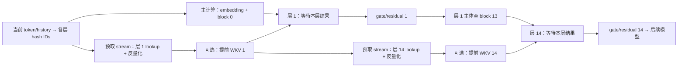

# Engram 预取与 decode 延迟隐藏

2026-10-21。本页保留原实验基线 RTP-LLM **main `492ecf45b3ef55b22fd4882622abfdb2e2f664f2`** 的分析与实测，并补充本日迁移到 `feature/dsv41-release-20261019` 的源码差异。历史结果不能作为新基线的验收。

## 新 release：prefill 已有预取，decode 尚未使用

新开发分支 `codex/engram-sidecar-dsv41-release-20261019` 基于 release **`cb42b084a8a6350daa70897555f18d5f1b47f58e`**。该版本的预取行为如下：

| 路径 | release 行为 | 对 external EGM 的意义 |
|---|---|---|
| 普通 target prefill，非 decode role | 默认 `DSV41_CPU_ENGRAM_LOOKUP=1`：CPU 后台 hash/gather，选中行经侧流 H2D；可保留 packed FP8/scale | EGM consumer 没有 CPU weight/scale 视图，不能直接使用这条路径 |
| 普通 target prefill，可选 GPU 预取 | CPU lookup 关闭，且 `DSV41_ASYNC_ENGRAM_LOOKUP=1`；两层 lookahead、最多一个 pending lookup，以 event 连接生产和消费 | 需要独立验证外部 allocation 的跨 stream 持有与清理，不能照搬本机 `_pinned` 事件容器 |
| decode、target verify、CUDA capture | 不创建上述 prefetch plan，继续同步 GPU 查表 | 目前没有现成的 decode 预取收益；下面的 decode 隐藏方案仍需实现和测量 |

源码：[prefetch 选择](https://github.com/alibaba/rtp-llm/blob/cb42b084a8a6350daa70897555f18d5f1b47f58e/rtp_llm/models_py/model_desc/deepseek_v41_model.py)、[CPU/GPU lookup 调度](https://github.com/alibaba/rtp-llm/blob/cb42b084a8a6350daa70897555f18d5f1b47f58e/rtp_llm/models_py/modules/dsv41/engram.py)。两条现有 prefill 优化均提前查表；不能据此认为 WKV、gate 或整个 Engram 层已经移到前面。

本次 rebase 保留本机 release 优化；外部 EGM 暂时按能力关闭不兼容的 CPU/异步预取入口，继续既有直接 GPU 读取。后续“存储开销”对照需在两边显式使用相同策略，例如都设 `DSV41_CPU_ENGRAM_LOOKUP=0`、`DSV41_ASYNC_ENGRAM_LOOKUP=0`；release 默认本机 prefill 性能另列。不得把不对称开关造成的差异全部归因于 EGM。

新 release 还改变了 native ABI、Graph 路径和 CUDA13 ARM 依赖；完整模型必须重新构建并验证，不能沿用旧 main 运行库或历史性能数字。

## 旧 main 实现：提前计算 hash，到层后才查表

| 阶段 | 当前行为 | 能否算在线权重预取 |
|---|---|---|
| 初始化 | 建立共享 pinned 表、触及源页；CPU 路径 `_prefault_host_tensor` 有 `MADV_WILLNEED`/逐页访问 | 属于启动准备，不与每次 decode 的前序层计算重叠 |
| 本次 forward 开始 | `_prepare_engram` 用 token history 计算所有 Engram 层的 hash，保存各层 IDs 与 mask | IDs 已提前准备；没有提前读 weight/scale |
| 到达 Engram 层 | `Block.forward_decode` 在该层 attention 前调用 `_inject_engram` | 仍在使用点发起读取 |
| Engram 内部 | `embed_tokens` 查表/反量化 → `wkv(rows)` → `gated_engram_residual(hidden, kv, …)` | 当前依赖链串行；没有 Engram 独立预取 stream/event |

main 固定提交源码：[hash 准备](https://github.com/MMadhatter/rtp-llm/blob/492ecf45b3ef55b22fd4882622abfdb2e2f664f2/rtp_llm/models_py/model_desc/deepseek_v41_model.py#L86)、[decode 层入口](https://github.com/MMadhatter/rtp-llm/blob/492ecf45b3ef55b22fd4882622abfdb2e2f664f2/rtp_llm/models_py/modules/dsv41/block.py#L354)、[查表/投影/gate 顺序](https://github.com/MMadhatter/rtp-llm/blob/492ecf45b3ef55b22fd4882622abfdb2e2f664f2/rtp_llm/models_py/modules/dsv41/engram.py#L748)、[lookup kernel](https://github.com/MMadhatter/rtp-llm/blob/492ecf45b3ef55b22fd4882622abfdb2e2f664f2/rtp_llm/models_py/modules/dsv41/_engram_triton.py#L92)。跨层 delayed-mHC 优化在下一层带 Engram 时拒绝该融合，也没有替 Engram 建立异步读取路径。

GPU lookup 通过映射后的 weight/scale 地址读取 FP8/E8M0，反量化成**当前 GPU 的 BF16 选中行**。consumer 后续使用的就是这个形态；整张表继续由 Owner 持有。CPU launch 返回是异步的，并不意味着同一 GPU stream 内的查表已与后续模型计算并发。

## 可以提前哪些工作

查表只依赖当前 token/history 得到的 row IDs；WKV 投影只依赖查表结果与固定投影权重。两者均不依赖目标层的 hidden state。gate/residual 依赖 hidden，必须在目标层输入就绪后完成。



图表示拟开发的依赖关系；不保证硬件调度必然并发，也没有承诺窗口长度。实现时按最早使用顺序先准备层 1，再准备层 14，各层使用独立完成事件。**层 1 的主流不能等待整个预取 stream 完成**，否则会连尚未需要的层 14 一起等完。

首个版本只提前 lookup/反量化，保持 WKV/gate 原序；第二个版本再测提前 WKV。这样可识别收益来自访存重叠，还是连投影也移出了关键路径。该模型 Engram 的零基索引为 1、14；层 14 的理论提前量更大，层 1 是更紧的使用期限。

这里是**当前 decode step 内跨层提前**。普通自回归解码尚不知道下一 token，不能假定可以跨到下一 step 预取。MTP/投机分支是另一个实验范围。

## “可用空间”应按关键路径计算

对一层的简化模型，`L` 表示预取支路完成所需时间，`W` 表示从该支路发起到主流需要结果之间可利用的计算窗口：

```text
该层暴露等待 ≈ max(0, L − W)

相同预取方案下，远端相对本机的额外等待
  ≈ max(0, L_remote − W) − max(0, L_local − W)
    + 远端与本机的调度/事件开销差 + 共享资源竞争引起的变化
```

示意而非实测：`W=80µs`、本机支路 `20µs`、远端支路 `60µs`，两者都能在使用前完成；远端增加的 `40µs` 不必暴露为额外等待。若远端变为 `140µs`，仍约有 `60µs` 等待。多层实际构成依赖图，窗口会受前层等待、资源争用和预取排队改变，不能把每层公式简单求和冒充 TPOT。

因此可以有比“完全串行裸查表”更大的延迟余量，但不能在尚未测得真实 `W` 前下结论；多实例访问同一 Owner 后的带宽排队、极端长尾也不会因预取消失。完整模型会同时测量原始 lookup 时间、使用点等待时间、前序计算是否变慢以及最终 decode/HTTP 延迟。

## 目前速度的实测范围

下面为**真实完整两张表、M1、两个 lookup 连续串行、CUDA Graph GPU event interval**。每个分布 10,000 对；没有模型层间计算，也没有在线预取。来源：[已发布 joint 原始数据与报告](results/20261021_joint_numa_v2/README.md)。

| 正常 run2 | 本机两层 P50 | 远端两层 P50 | 配对远端−本机 P99 |
|---|---:|---:|---:|
| hot IDs | 12.192µs | 18.272µs | 7.936µs |
| random IDs | 16.768µs | 20.032µs | 7.360µs |

配对差值分位数来自逐对计算，不能用两个绝对分位数相减替代。随机 ID 工作集小于整表，不能称为全表冷读。scratch 扰动 run3 的 M1 random 仍出现 **3/10,000 个 GPU 配对增量超过100µs，最大1329.984µs**。因此≤100µs的稳定性目标尚未通过，尚不能靠假设的预取窗口消除这些证据。

当前组件计时从 IDs 已准备好开始，到选中 BF16 行完成，未包括 hash/history、WKV、gate、前序层、MoE/EP 或 HTTP。它能检验存储读取路径，不能直接等同于完整 decode 增量。

## 轻量实现与 Graph 约束

- Owner/sidecar 仍只提供同一物理表的映射；每 token 不增加 RPC、CPU 查表或远端返回流程。consumer 的预取 kernel 直接读 EGM。
- 每个 RTP worker 建立少量预取 stream 与**每层完成 event**，按 Graph bucket/并发 slot 准备固定地址的暂存区。hash 完成后建立依赖；到对应层才等待该层事件。在线路径不用主机 `synchronize()`。
- 一层 M1 的选中 BF16 行约 `24 × 256 × 2 = 12KiB`。当前维度下提前投影后的结果为 `5 × 5120 × 2 = 50KiB`/层/token。另计 hash、量化工作区、Graph pool 与并发 slot；不是复制188.8GiB完整权重。prefill 长输入必须继续有界分块，不把全部token/所有层无限预取。
- CUDA Graph 中把预取和主计算一起 capture，正确 fork/join，依赖属于同一 graph；capture 结束前子 stream 必须归并到原捕获 stream。运行时真正并发取决于依赖与硬件资源。[NVIDIA capture 约束](https://docs.nvidia.com/dl-cuda-graph/cuda-graph-basics/constraints.html)、[CUDA 13.2 异步执行](https://docs.nvidia.com/cuda/archive/13.2.1/cuda-programming-guide/03-advanced/advanced-host-programming.html)。
- 不把 Python 中上次 forward 的 rows/kv 当成下次 replay 的新数据。每次 replay 必须按本次 token/history 更新全部有关输入，保证输出缓冲区不被仍在使用的请求覆盖；多 slot 是否必要由现有调度并发契约决定。
- 外部 backing、tensor view、Graph 与预取任务共享明确的生命周期；主流消费结束后才可复用 slot。进程退出须先排空主流与预取流，再释放图、视图与映射。
- 首版不引入 PDL。当前是独立查表工作与前序模型计算之间的并发，stream/event 足以表达；WKV 和查表内部进一步流水化另行评估。

## 开发与验收顺序

1. **先完成当前无预取完整模型基线。** 本机/远端分别验证正常输出、真实 Graph capture/replay与相同配置下的 decode 指标。保留两层各自开始/结束和使用期限的真实时间线。
2. **拆分接口但不改变执行序。** 把 `lookup_rows(ids)`、`project_rows(rows)`、`inject(hidden, kv, mask)` 明确拆出；原同步入口保持相同输出与算子顺序。覆盖空 batch、padding、不同 IDs/history、dtype/scale、token mask、异常与资源引用。
3. **只提前 lookup。** 本机和远端都支持同一开关。验证每层 event 依赖、跨 stream 输出生命周期、没有整表复制、两层独立等待；先 eager correctness，再 Graph 连续变更输入的 replay correctness。
4. **评估提前 WKV。** 同样验证数值；测它是否占用 SM/带宽拖慢主计算，以及对第一 Engram 层 deadline 的影响。没有收益就保留只预取 lookup。
5. **成对完整模型测量。** 存储本机/远端 × 无预取/只lookup预取/lookup+投影预取，分别报告迁移收益（远端新方案对本机旧方案）和存储成本（两边同优化）。测试 M1及实际decode batch、多consumer并发、正常与扰动条件，报告每层暴露等待、实际GPU step、HTTP请求均值TPOT及尾部；不把请求均值TPOT冒充逐步尾延迟。
6. **生命周期/Graph验收。** 连续不同token与请求slot、不够/多余padding、captured bucket复用、错误传播、停止/卸载、Owner依赖期间映射持续有效。profile只定位依赖与瓶颈；最终延迟在无profiler配置下复验，保留所有异常和未复现情况。

本次讨论不把“裸查表增量≤100µs”自动改成“隐藏之后≤100µs”。两种口径分别报告；端到端收益需要真实模型证据。
