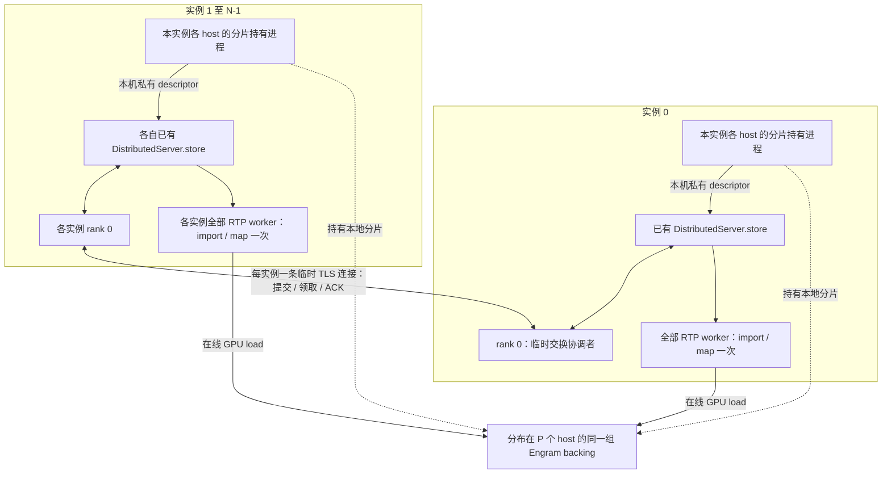

# 静态 N 实例、P host：一次交换，在线直接读内存

本轮实现采用最少新增连接的方式：**实例内复用已有 TCPStore；实例间只有 rank 0 建立临时 RPC；在线查表不调用 RPC，也不读取 Store。** 没有新增 sidecar 容器或集中存放完整表的 Owner。



## 开销与边界

| 项目 | 行为 |
|---|---|
| 单实例、多 host | 只复用实例内 Store；不启动跨实例 RPC |
| N 个实例 | 正常一次启动新增 N−1 条 TLS/TCP 连接，不构建全互联 |
| 每条连接 | HTTP/1.1 keep-alive，复用提交元数据和 ACK；不是每条请求重新建联 |
| 协调者 | 固定为成员列表第一个实例的 rank 0；只合并元数据，本实例仍只持有分配给自己的分片 |
| 启动完成 | 全部代表确认同一 payload 后关闭交换监听；worker 从本地缓存建立映射 |
| 在线推理 | 0 次新增 RPC、0 次新增 Store 读取；原有 GPU lookup/prefetch 路径不变 |
| 权重数据 | 不经过 RPC；GPU 经已验证可用的 Fabric/EGM 映射访问各 host 分片 |
| 内存生命周期 | 持有进程继续保留 backing，不能因 RPC 关闭而释放 |

这是消除**控制通道的逐请求开销**，不是承诺跨 host DRAM 读取等于本机 pinned 延迟。实际 lookup、prefetch 隐藏比例和完整 decode 增量仍须另测。控制路径使用 Python 标准库，不增加 gRPC/protobuf 依赖；TCP/TLS 是启动成本。

## 配置与自动接入

拓扑输入由 `distributed_plan.py` 处理。既有 `instances`、`storage_hosts`、`storage_host_count=P` 保持不变；增加：

```json
{
  "instance_count": 2,
  "storage_host_count": 4,
  "generation": "由本次组启动统一生成的 UUID",
  "checkpoint": "/models/DeepSeek",
  "model_revision": "不可变模型版本",
  "publication_root": "/run/engram",
  "storage_hosts": [
    {"host_id":"host-A","device":0,"numa":0},
    {"host_id":"host-B","device":0,"numa":0},
    {"host_id":"host-C","device":0,"numa":0},
    {"host_id":"host-D","device":0,"numa":0}
  ],
  "instances": [
    {"instance_id":"i0","hosts":["host-A","host-B"],"local_world_size":4},
    {"instance_id":"i1","hosts":["host-C","host-D"],"local_world_size":4}
  ],
  "exchange": {
    "coordinator":{"host":"实例 i0 的 rank 0 可达 IP","port":29483},
    "timeout_seconds":1800,
    "tls": {
      "i0": {
        "ca_file":"/run/engram/pki/ca.pem",
        "cert_file":"/run/engram/pki/member-0.pem",
        "key_file":"/run/engram/pki/member-0.key",
        "instance_cert_sha256":{"i0":"i0 证书 DER SHA256，64 位小写 hex","i1":"i1 证书 DER SHA256"}
      },
      "i1": {
        "ca_file":"/run/engram/pki/ca.pem",
        "cert_file":"/run/engram/pki/member-1.pem",
        "key_file":"/run/engram/pki/member-1.key",
        "instance_cert_sha256":{"i0":"同上","i1":"同上"}
      }
    }
  }
}
```

上面是字段示例，文字占位符需要替换。`hosts` 顺序必须与实际 WORLD_RANK 分配一致：host index × local_world_size 对应本 host 的发布者 rank。每个实例允许不同 local_world_size，但目前同一实例内部使用一致的 local_world_size。

P 可配置为 2–64，N 为 1–64。每个实例至少持有一个分片；当前一物理 host 一 holder，因此 P≥N。物理 host 重叠时必须显式指定 storage_host.instance_id，不能重复加载一片。运行期间固定 N/P/成员/generation，不支持加入新实例、自动补片、缩组或选主。

单实例使用 `"exchange": {}` 即可，不需要 coordinator/TLS；仍须配置真实 worker 拓扑。

### 启动器做什么

1. 为本次组启动生成一个 UUID；确定 N/P、完整成员表、host 身份及 rank 顺序。所有节点必须处于可共享的 NVLink/IMEX 域，并具有相应权限。IP 可达不代表 Fabric 可导入。
2. 给每个实例的 rank 0 提供它自己的证书、私钥、CA 和相同的完整证书指纹表；使用平台 PKI。证书 SAN 必须覆盖 coordinator IP/域名。不要把 CA 私钥分发到业务节点。
3. 在已有开发/业务容器内生成计划：

   ```bash
   python3 -m tools.engram_sidecar.framework.distributed_plan \
     --config /private/group.json \
     --output-directory /private/generated-plan
   ```

4. 读取 `launch-plan.json`，在对应 host 启动每条 `holders[].argv`。这是容器内的分片持有进程，不是新 sidecar。启动器负责保活和组退出顺序。
5. 将生成的 `startup-0.json` / `startup-1.json` 分发给对应实例的所有 host，放在各自 `consumers[].env.RTP_ENGRAM_STATIC_GROUP_CONFIG` 指定路径。目录私有，文件由 RTP 用户持有且权限 0600。分发的是启动配置，**无需人工收集/复制 Fabric handle**。
6. 对每个实例设置 `consumers[].env` 后启动原有 RTP 命令。`BackendManager.start()` 在 DistributedServer 就绪后、NCCL/模型创建前调用 `prepare_static_engram()`。
7. 启动适配器等待本机 holder 的 descriptor，经现有 Store 汇集到 rank 0；跨实例自动交换完整元数据；所有 worker 自动生成私有本地缓存并沿现有 bootstrap 导入、GPU 样本校验，再进行模型 warmup/Graph。
8. 模型自身 ready 后才接流量。交换完成仅表示元数据齐备，不等于所有 GPU/模型已 ready。

测试证书可由下列工具生成（两天有效，仅开发实验）：

```bash
python3 -m tools.engram_sidecar.framework.make_exchange_test_certs \
  --output /private/test-pki --member i0 --member i1 --server-ip COORDINATOR_IP
```

输出的 `tls-config.json` 可以直接填入 `exchange.tls`；部署到容器时同步调整文件路径。只分发各实例自己的 key/cert 和 CA 公钥，不共享其他实例的私钥。

## RPC 与校验

| 接口 | 请求 | 作用 |
|---|---|---|
| POST /v1/exchange | instance_id、group_digest、该实例全部 descriptor | 等待 N 个实例齐备；返回同一 manifest、capabilities、samples |
| POST /v1/ack | instance_id、完整响应的 payload_digest | 所有代表确认相同结果后返回，连接关闭 |

- mTLS 验证 CA，并把客户端证书指纹绑定到 instance_id；客户端另外固定 coordinator 的证书指纹。不能只改 instance_id 冒充其他实例。
- 组摘要绑定 generation、模型版本、成员和 rank/host/shard 分配；检查每个 descriptor 的归属、完整 P、shape、布局、hash ABI、allocation ID、句柄集合。
- 同一实例相同提交可幂等；不同内容重报拒绝。缺成员、慢成员、缺 ACK、组不一致、TLS 失败均有超时/拒绝路径，不自动降低 N/P。
- 协调者从本地 checkpoint 计算每片边界和全局中间行的样本摘要；GPU import 后真实读取并比对。此样本校验不等于每个消费者重算完整权重 hash。
- JSON 有大小上限，不用 pickle，不记录 capability/私钥。Store 复用现有实例信任边界，前缀隔离不是新增认证机制。
- 每个 worker 生成一个 0700 临时目录，内部 manifest/capabilities/bundle 为 0600。它是自动生成的启动缓存；在线不读取文件。缓存仍包含能力信息，不应提交日志或 Git；进程退出后由启动器清理。
- ACK 完成后清理本次 Store 元数据。任何失败都不能据此释放 backing：必须先停同组全部模型 worker、排空 GPU/Graph，再停止 holder。

## 代码入口

- `rtp_llm/models_py/modules/dsv41/engram_exchange.py`：有界 mTLS RPC、固定成员 barrier、身份绑定。
- `engram_startup.py`：已有 Store 汇集/广播、rank 0 交换、本地缓存。
- `engram_descriptors.py`：RPC 和离线工具共用同一分片校验。
- `rtp_llm/server/backend_manager.py`：模型创建前的启动钩子；未设置环境变量时立即跳过。
- `distributed_plan.py`：生成 holder 命令、启动配置和环境变量；离线 bundle 模式仍供诊断使用。
- `native/probe_static_exchange_cuda.py`：双 host、双实例、每实例两个 worker 的真实 CUDA 集成探针。

## 测试与已知限制

结果见 [本轮验证记录](rpc_20261030/RESULTS.md)。本轮将 startup 适配器、真实 TCPStore、跨容器 mTLS、跨 host Fabric 映射、样本校验和 Graph 串联测试；没有重启已有完整 P/D 服务，也没有把小表读取冒称为完整模型 chat 或 decode 性能结果。

BackendManager 已接入钩子，但该新 RPC 路径的完整模型 chat、完整 checkpoint 启动时间及 <100 μs decode 增量尚需单独验收。启动器目前仍需启动各 host 的 holder 进程；本次不包括 C2 调度、运行时健康探测和高可用。一个 holder/host 失效需整组停止/重建，不能通过重连 RPC 修复已经失效的映射。
